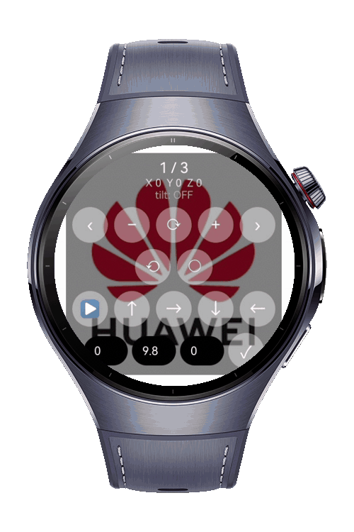

> **Note:** To access all shared projects, get information about environment setup, and view other guides, please visit [Explore-In-HMOS-Wearable Index](https://github.com/Explore-In-HMOS-Wearable/hmos-index).

# How to Build Gesture Engine

The `how_to_build_gesture_engine` codelab demonstrates how to build a multi-modal gesture
engine on HarmonyOS smart wearables. It combines touch gestures, hardware buttons, and
accelerometer input into a single photo viewer experience.

# Preview

<div>
  
</div>

# Use Cases

- **Pinch to zoom**: A two-finger `PinchGesture` scales the current photo. The scale factor is
  clamped between 0.5x and 5x, and committed as the new base scale when the gesture ends.
- **Rotate**: A two-finger `RotationGesture` rotates the photo by the reported angle delta,
  accumulating on top of the previous angle.
- **Swipe to navigate**: A single-finger horizontal `PanGesture` swipes to the next or previous
  photo once the offset passes a threshold. Pinch, rotation, and pan run together in a parallel
  `GestureGroup`.
- **Hardware buttons**: The watch TOP / BOTTOM keys (mapped via `KeyCode`) navigate between
  photos through `onKeyEvent`.
- **Accelerometer tilt**: The `@kit.SensorServiceKit` accelerometer feeds live X / Y / Z readings,
  which are displayed on screen as the device is tilted.
- **Auto reset**: Switching photos resets scale and rotation back to their defaults.

# Tech Stack

- **Languages**: ArkTS / ArkUI
- **Frameworks**: HarmonyOS SDK 6.0.1(21)
- **Tools**: DevEco Studio(6.0.1)
- **Libraries**:
    - `@kit.ArkUI`
    - `@kit.AbilityKit`
    - `@kit.SensorServiceKit`
    - `@kit.InputKit`
    - `@kit.BasicServicesKit`

# Directory Structure

```
entry/src/main/
|---ets/
|   |---entryability/
|   |   |---EntryAbility.ets
|   |---entrybackupability/
|   |   |---EntryBackupAbility.ets
|   |---model/
|   |   |---GestureModels.ets      // Action / ActionType / Axis / Button enums + Pinch / Rotate / AxisValue interfaces
|   |---viewmodel/
|   |   |---PhotoViewerViewModel.ets // gesture handlers, sensor lifecycle, navigation state
|   |---pages/
|       |---Index.ets              // Stack UI, GestureGroup, onKeyEvent wiring
|---resources/
|   |---base/
|   |   |---element/
|   |   |   |---color.json
|   |   |   |---float.json
|   |   |   |---string.json
|   |   |---media/                 // p1.png, p2.jpg, p3.jpg + app icons
|   |   |---profile/
|   |   |       |---main_pages.json
|   |   |       |---backup_config.json
|   |---dark/
|       |---element/
|           |---color.json
|---module.json5
```

# Constraints and Restrictions

## Supported Devices

- Huawei Watch 5

## Permissions

- ohos.permission.ACCELEROMETER

# License

Gesture Engine is distributed under the terms of the MIT License.
See the [LICENSE](LICENSE) for more information.